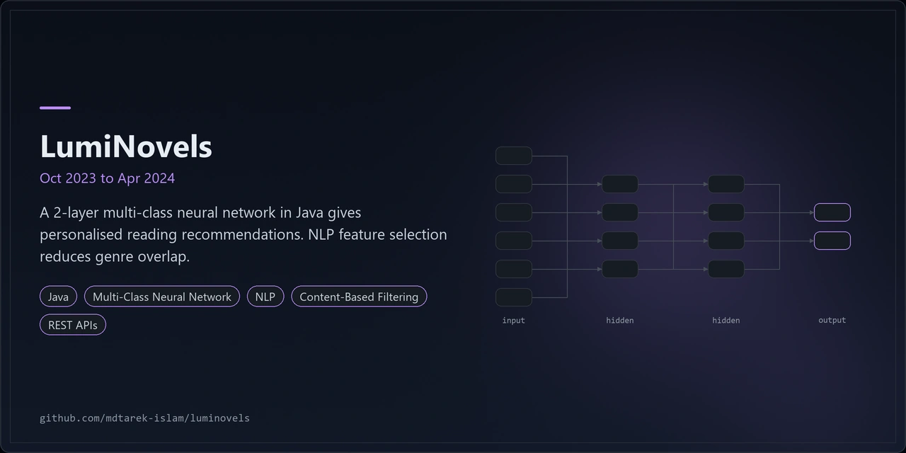
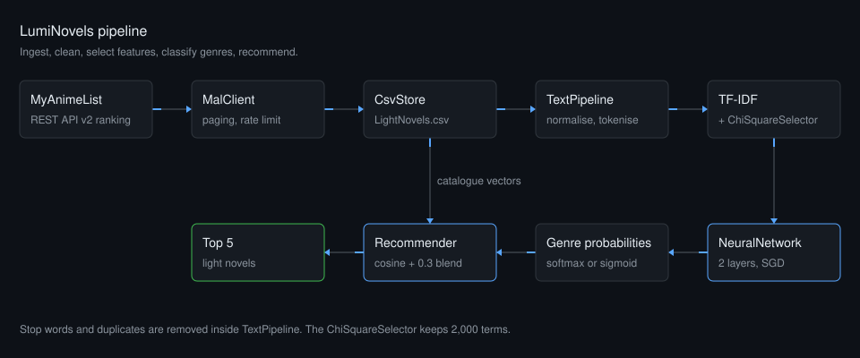
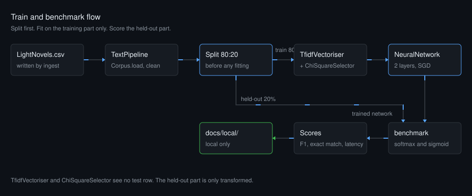

<p align="center"></p>

# LumiNovels

Light novel recommendations from a 2-layer neural network and content-based filtering.

## Overview

LumiNovels recommends light novels. A 2-layer multi-class neural network predicts genres from synopsis text. Content-based filtering then ranks similar titles. NLP feature selection reduces genre overlap.

The project ran from Oct 2023 to Apr 2024. This repository holds the original reports and the pipeline in plain Java.

| Layer | Technology |
|---|---|
| Language | Java 17 target, built with JDK 21 |
| Model | Multi-class neural network, 2 layers, written from scratch |
| NLP | TF-IDF, chi-square feature selection |
| Recommendation | Content-based filtering with cosine similarity |
| Data | MyAnimeList REST API v2, CSV cache |
| Libraries | Jackson, JUnit 5 |
| Build | Maven |

## Results (Oct 2023 to Apr 2024)

- Classifier layers: 2.
- Samples preprocessed via REST APIs: 10,000+.

Measured in the Oct 2023 to Apr 2024 project. See `LumiNovels_Final_Report.pdf` and `LumiNovels_Progress.pdf` in this repository.

## Architecture



1. `MalClient` pages through the MyAnimeList ranking endpoint and limits the request rate.
2. `CsvStore` caches the entries in one CSV file.
3. `TextPipeline` normalises text, splits tokens, removes stop words and drops duplicates.
4. `TfidfVectoriser` weights terms. `ChiSquareSelector` keeps 2,000 terms and drops terms that overlap more than 3 genres at p = 0.05.
5. `NeuralNetwork` has 2 layers and predicts genre probabilities.
6. `Recommender` blends content cosine with the classifier's genre probabilities and returns the top 5.

### Train and benchmark flow



*The data splits 80:20 before any fitting. TF-IDF and chi-square selection fit on the training part only, so the test part never leaks into the features. The network trains in softmax or sigmoid mode. `benchmark` writes its scores to `docs/local/`, which stays local.*

## Features

- Generates personalised reading recommendations with a 2-layer multi-class neural network classifier in Java.
- Extracts and pre-processes over 10,000 data samples through REST APIs.
- Improves feature selection with NLP techniques that reduce genre overlap, and applies content-based filtering.
- Retries on status 403, 429 and 5xx, up to 5 times, with a doubling wait from 2 seconds. Requests are at least 1 second apart.
- Runs four commands: `ingest`, `train`, `benchmark` (alias `evaluate`) and `recommend`.
- Queries by free text (`--query`) or by liked titles (`--like`).
- Benchmarks accuracy, macro and micro F1, exact match and latency percentiles. The results stay in `docs/local/`.

### Engineering findings

- Build status: compiles with JDK 21 (target Java 17) and Maven. `mvn -q -B test` passes all 38 tests.
- Ingest reads MyAnimeList `ranking_type=all` and keeps `media_type=light_novel`. The `novels` ranking type is capped by the API.
- TF-IDF and chi-square selection fit on the training split only. The test split never reaches them.
- The original project reported a cached `LightNovels.csv` of 10,343 entries across 71 genres. That report used word-level TF-IDF, a ReLU hidden layer of 100 units, Xavier initialisation, 100 epochs and an 80:20 split.
- Differences from the original project:
  - The original used Deeplearning4j. This build writes the network from scratch.
  - The original reached its best scores with Adam. This build uses mini-batch SGD only.
  - The original merged 71 genres into 26 groups with K-means++. This build does not.
  - The original also queried AniList. This build uses MyAnimeList only.
  - The original used OpenNLP for tagging and lemmatising. This build uses a fixed stop word list.
- Output default is softmax with cross-entropy. Pass `--activation sigmoid` for the original report setup: sigmoid with binary cross-entropy.

## Quick start

Install JDK 21 and Maven. Then run:

```bash
git clone https://github.com/mdtarek-islam/luminovels.git
cd luminovels
mvn -q -B test
mvn -q package
export MAL_CLIENT_ID=your-client-id
mvn -q exec:java -Dexec.args="ingest --ranking-type all --media-type light_novel --out data/LightNovels.csv --max 10500"
mvn -q exec:java -Dexec.args="train --data data/LightNovels.csv"
mvn -q exec:java -Dexec.args="recommend --data data/LightNovels.csv --query 'isekai adventure' --top 5"
```

`mvn package` builds a jar without bundled dependencies, so use `exec:java` to run the commands.

## Configuration

| Setting | Default | Notes |
|---|---|---|
| `MAL_CLIENT_ID` | none | Environment variable, or a local dotenv file read by `DotEnv`. Sent as the `X-MAL-CLIENT-ID` header and never logged. `--client-id` overrides it. |
| `--ranking-type` | `novels` | Pass `all` for a full run. `novels` is capped by the API. |
| `--media-type` | none | Pass `light_novel` to keep only light novels. |
| `--page-size` | API maximum | Entries per request. |
| `--out`, `--data` | `data/LightNovels.csv` | CSV cache path. |
| `--model-dir`, `LUMINOVELS_MODEL_DIR` | `models` | Model folder. The flag wins over the variable. |
| `--model` | `<model-dir>/luminovels.model` | Explicit model file. |
| `--max` | `10500` | Entries to fetch. |
| `--interval-ms` | `1000` | Minimum gap between requests. |
| `--epochs`, `--hidden` | `100`, `100` | Training length and hidden units. |
| `--lr`, `--batch`, `--seed` | `0.01`, `32`, `42` | Learning rate, batch size, random seed. |
| `--features`, `--min-df`, `--max-overlap` | `2000`, `2`, `3` | Feature selection limits. |
| `--activation` | `softmax` | `train`: `softmax` or `sigmoid`. `benchmark`: also `both`, the default there. |
| `--test-split` | `0.2` | Test share of the data. |
| `--out-dir` | `docs/local` | `benchmark` output folder. |
| `--top`, `--alpha` | `5`, `0.7` | Result count and content cosine weight. |

`data/`, `models/`, `*.model` and `docs/local/` are git-ignored. `DESIGN_NOTES.md` lists every choice that differs from the reports.

## Usage

```bash
# Fetch light novels into the CSV cache
mvn -q exec:java -Dexec.args="ingest --ranking-type all --media-type light_novel --out data/LightNovels.csv --interval-ms 1000"

# Train with the report setup
mvn -q exec:java -Dexec.args="train --data data/LightNovels.csv --activation sigmoid"

# Benchmark both output modes and write the results to docs/local
mvn -q exec:java -Dexec.args="benchmark --data data/LightNovels.csv --model-dir models --out-dir docs/local --activation both"

# Recommend from free text
mvn -q exec:java -Dexec.args="recommend --data data/LightNovels.csv --query 'school romance' --top 5"

# Recommend from liked entry IDs
mvn -q exec:java -Dexec.args="recommend --data data/LightNovels.csv --like 101,202 --top 5 --alpha 0.7"
```

Run `mvn -q exec:java` with no arguments to print the usage text. `train` saves `luminovels.model`. `benchmark` saves one model per mode, such as `luminovels-softmax.model`. Pass `--model` to `recommend` when you trained with another name.

## Licence and contribution

MIT licence. See [LICENSE](./LICENSE). Raise bugs and suggestions as GitHub issues on this repository.

## Maintenance status

Maintained: the code compiles with JDK 21 and `mvn test` passes on main.
